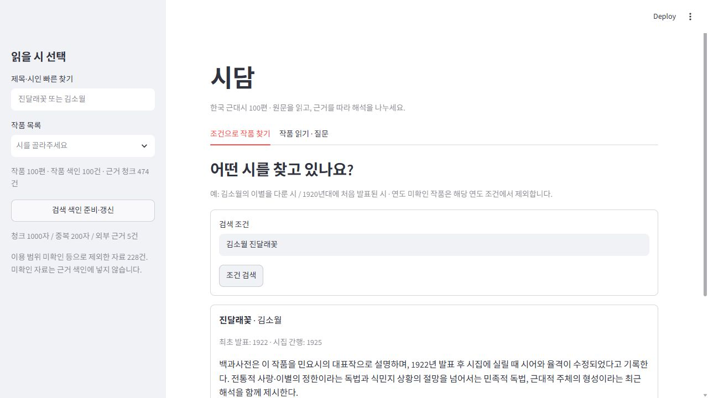
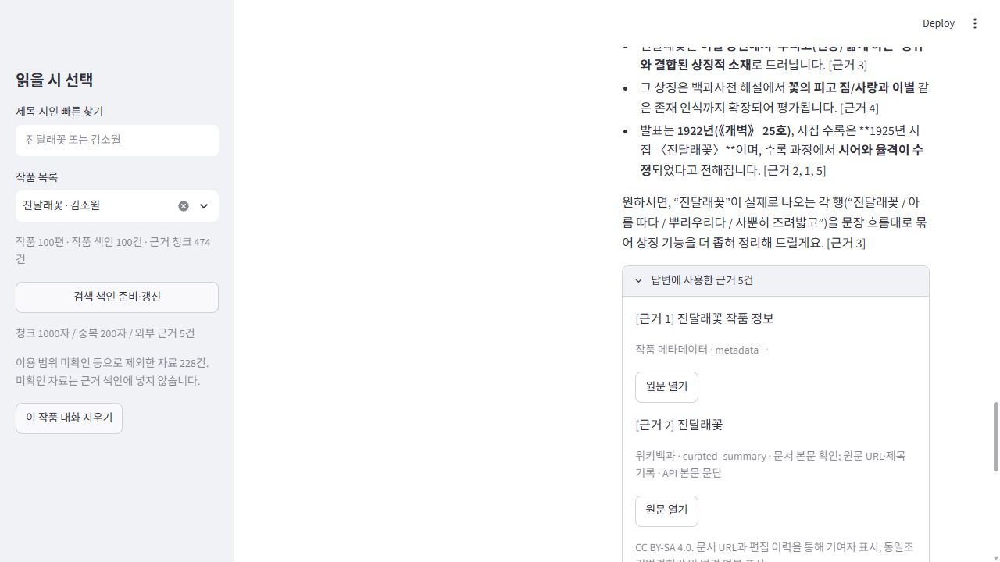
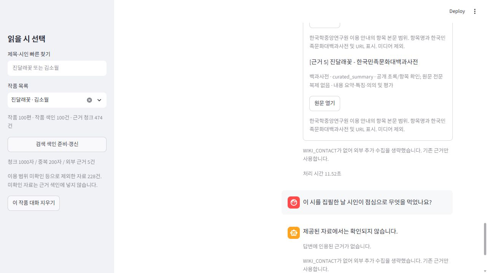
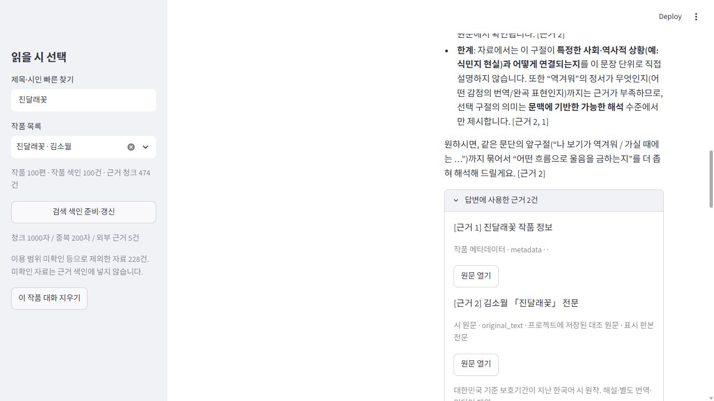

# 현재 main E2E 검증 — ISSUE #7

검증일: 2026-10-23. 대상 코드 main `69e393c`. 계획: [E2E-007](../specs/E2E-007.md).

## 환경·빌드

원격 main을 `tmp/e2e-current-1792714110207`에 새로 clone하고, 해시 잠금 의존성을 설치한 Python 3.12.10 환경에서 실행했다. 기존 사용자 앱 8501과 별도인 8502에서 실제 in-app 브라우저를 조작했다. 키는 프로세스 환경으로만 전달했으며 `.env`를 복사하지 않았다. 추가 수집 연락처를 비워 이번 UI 검증에서는 기존 공개 기준 자료만 사용했다. 실시간 추가 수집 검증은 이번 범위에서 미확인이다.

- `python -X utf8 -m compileall -q sidam scripts step7_skeleton.py`: 성공.
- `python -m pytest -q`: 43 passed, 14.90초. 가짜 HTTP/LLM·임시 DB 사용.
- `python scripts/verify_repro.py`: 100작품·343문서·474청크·제외 228건 일치.
- 실제 GMS 초기 기준 색인: 32.41초. 반복 색인: 2.98초. 질문 응답 시간과 별개다.
- 별도 실제 CLI 질문: 9.06초(검색 3.141초·생성 5.922초), 모든 검색 근거의 poem_id 일치, 1536차원 확인. CLI가 브라우저 질문보다 먼저 실행되어 UI 첫 요청을 완전한 provider cold start로 부르지 않는다.

## 실제 브라우저 결과

| 사례 | 판정 | 관찰 |
| --- | --- | --- |
| E01 제목·시인 | 통과 | 김소월 진달래꽃 → 해당 작품 1편 |
| E02 연도 | 통과 | 1922년 최초 발표 → 진달래꽃·엄마야 누나야, 미확인 제외 |
| E03 주제 | 통과 | 이별의 슬픔을 다룬 김소월 시 → 진달래꽃·예전엔 미처 몰랐어요·금 잔디·초혼. 표시 해설에 이별·그리움·죽음 정서가 연결됨 |
| E04 전문 | 통과 | 진달래꽃 전문·최초 발표 1922·시집 1925·전문 출처 표시 |
| E05 구절 카드 | 구조 통과·해석 검토 필요 | 실제 구절로 5개 카드 항목 생성, 6.39초. 원문과 메타데이터 2건을 인용함 |
| E05 상징·배경 | 구조 통과·해석 검토 필요 | 상징·발표·수록 질문 11.52초. 원문·위키·백과·작가 맥락 등 실제 인용 5건. 작가 일반론의 작품별 적용은 별도 문학 검토 대상 |
| E06 근거 | 통과 | 실제 인용 1·2만 펼침에 표시. 공유마당 메타데이터·시한잔 전문 링크와 원문 범위 확인 |
| E07 근거 부족 | 통과 | 집필 당일 점심 → ‘제공된 자료에서는 확인되지 않습니다.’, 인용 없음, 4.09초 |
| E08 작품 격리 | 통과 | 그날이 오면으로 전환 시 이전 대화·출처가 없음. 시집 1949·창작 1930·초출 미확인 표시. CLI 근거 poem_id도 선택 작품과 모두 일치 |
| E09 복원 | 통과 | 진달래꽃 복귀 시 카드·상징 질문·확인 불가 답변과 처리 시간이 보존됨. 과거 카드 출처 펼침은 당시 2건을 유지하며 이후 답변의 5건과 구분 |

## 한계와 다음 우선순위

인용 번호의 유효성은 주장에 대한 문헌적 지지와 다르다. 구절 카드의 ‘역겨워’를 ‘상대에게 가는 것이 부담스럽다’고 풀어 쓴 설명은 주체가 불분명하며 원문으로 충분히 지지되는 해석인지 검토해야 한다. 유일한 정답 해석으로 채택하지 않는다. 전체 문학 품질 통과를 주장하지 않으며 #4·#8·#12에서 고정 기준으로 검토한다.

자료 결손(주제 확인 31편·초출 확인 2편)은 그대로다. 현재 MMR·비교 러너는 미구현이다. 동명/표기·성능 문제는 반례·측정 이후 #9·#10에서 수정한다. NF2001 수치 목표 미확정, 상호 점검 미실시를 통과로 기록하지 않는다.

스크린샷은 [화면 폴더](screenshots/e2e-20261023/)에 저장했다. API 키·연락처·개인 대화는 포함하지 않는다. 공개 검증 질문과 해당 결과만 캡처했다.

